# REEMSEC DataGuard

### Sensitive Data & Secret Exposure Detection Platform

<p align="center">
  <strong>DETECT · ANALYZE · PROTECT</strong>
</p>

<p align="center">
  An automated cybersecurity platform designed to identify exposed credentials, sensitive information, and potential security risks across text, files, and supported documents.
</p>

<p align="center">
  Built with Python · FastAPI · JavaScript · SQLAlchemy · Tesseract OCR
</p>

<p align="center">
  <a href="https://github.com/reemi01/REEMSEC-DataGuard">GitHub Repository</a> •
  <a href="#system-architecture">System Architecture</a> •
  <a href="#installation--setup">Installation</a> •
  <a href="#application-screenshots">Screenshots</a>
</p>

---

# 1. Project Overview

**REEMSEC DataGuard** is a cybersecurity platform focused on detecting sensitive data exposure and potentially exposed secrets within submitted text, files, and supported documents.

The platform combines automated detection rules, file processing, Optical Character Recognition (OCR), risk assessment, evidence redaction, role-based access control, scan history, audit services, and security reporting.

It provides a centralized environment where users can submit content for scanning, review potential security findings, and access relevant security information according to their assigned roles.

### Project Objectives

- Detect potentially exposed credentials and secrets.
- Identify sensitive information in supported files and documents.
- Extract text from images and scanned PDFs using OCR.
- Classify findings according to severity.
- Calculate risk based on detected findings.
- Protect sensitive evidence through redaction.
- Provide role-based access to platform functionality.
- Maintain scan history and audit-related records.
- Support security analysis and reporting workflows.

# 2. Problem Statement

Sensitive information can unintentionally be exposed through source code, configuration files, documents, images, and other digital assets.

Examples include:

- Cloud access keys.
- API keys.
- Authentication credentials.
- Hardcoded secrets.
- Confidential configuration values.

When exposed, such information can create security risks, including unauthorized access, account compromise, and potential data breaches.

REEMSEC DataGuard addresses this challenge by providing an automated scanning workflow that analyzes supported content, identifies potentially exposed information, classifies findings, and presents results for security review.

# 3. Key Features

## 3.1 Secret & Sensitive Data Detection

- Automated scanning using detection rules.
- AWS access key pattern detection.
- Identification of potentially exposed credentials and secrets.
- Severity classification.
- Risk calculation.
- Sensitive evidence redaction.
- Structured security findings.

## 3.2 Text Scanning

Users can submit text directly to the platform for security analysis.

The detection engine analyzes submitted content using configured detection rules and returns potential findings with severity information and redacted evidence.

## 3.3 Multi-File Scanning

The backend provides file upload and scanning functionality for supported formats.

Supported formats include:

- PDF documents.
- PNG and JPG/JPEG images.
- TXT and LOG files.
- CSV files.
- Excel files.
- DOCX documents.
- JSON files.
- ENV files.
- ZIP archives where supported by the implementation.

Multiple files can be submitted within a scanning operation.

## 3.4 OCR Integration

The platform integrates **Tesseract OCR** to extract text from:

- Images.
- Scanned PDF documents.

Extracted text can then be passed to the detection engine for security analysis.

This allows the platform to analyze documents in which text is stored as an image rather than selectable text.

## 3.5 Risk Assessment

- Finding severity classification.
- Risk calculation.
- Severity summaries.
- Structured findings.
- Redacted evidence presentation.

## 3.6 Role-Based Access Control (RBAC)

REEMSEC DataGuard provides three user roles with different responsibilities and access permissions.

| Role | Main Responsibilities | Available Capabilities |
|---|---|---|
| Admin | Platform administration | Administrative dashboard, user management, and authorized administrative controls |
| Security Analyst | Security monitoring and investigation | Security findings, scan history, directory scanning, and intelligence reports |
| Employee | Performing authorized scanning operations | Scanning functionality, findings, and accessible scan history |

### Role Differences

**Admin**
- Manages users and administrative functionality.
- Accesses administrative dashboard features.
- Oversees authorized platform controls.

**Security Analyst**
- Reviews security findings.
- Investigates scan results.
- Accesses scan history.
- Uses directory scanning functionality.
- Reviews intelligence reports.

**Employee**
- Performs authorized text and file scanning.
- Reviews accessible scan results.
- Accesses permitted scan history.

Access to each feature is controlled by the application's role-based authorization system.

## 3.7 Scan History

The platform provides persistent scan history functionality to support:

- Reviewing previous scans.
- Tracking scan outcomes.
- Reviewing finding counts.
- Monitoring completed scanning operations.

## 3.8 Intelligence Reports & Export

The platform provides intelligence reporting functionality for authorized roles and supports exporting available results.

## 3.9 Directory Scanning

Backend directory-scanning functionality supports scanning workflows involving directories and their supported contents.

## 3.10 Audit Services

Audit-related backend services support recording and reviewing relevant application activities.

---

# 4. System Architecture

REEMSEC DataGuard follows a layered frontend/backend architecture.

The frontend provides the user interface and role-based dashboards. The FastAPI backend handles application requests, authentication, authorization, scanning operations, risk assessment, and data persistence.

This section documents the system architecture, its major components, and the logical workflows used by the application.

## 4.1 High-Level System Architecture

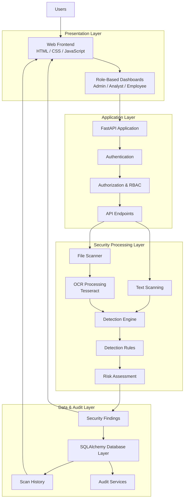

## 4.2 Architectural Layers

| Layer | Components | Responsibility |
|---|---|---|
| Presentation | Frontend and role-based dashboards | User interaction and displaying results |
| Application | FastAPI, authentication, authorization | Request handling and access control |
| Processing | Text scanner, file scanner, OCR, detection engine | Content extraction and security analysis |
| Risk Assessment | Risk engine | Risk calculation and severity summaries |
| Data | SQLAlchemy and persistence services | Application data and scan history |
| Audit | Audit services | Audit-related application records |

## 4.3 Backend Component Architecture

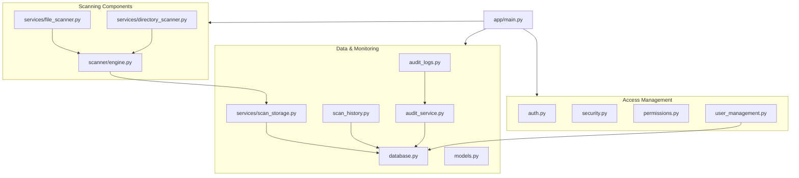

*Note: This is a logical component view based on the repository structure. It does not claim to represent every runtime dependency or exact function call.*

## 4.4 Data Flow Diagram (DFD)

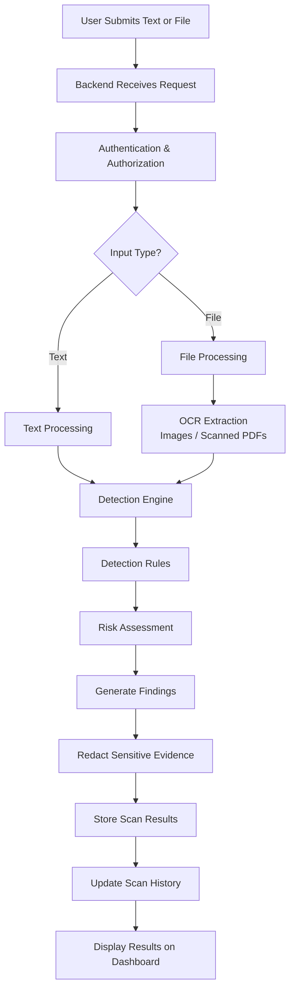

## 4.5 Authentication & Authorization Architecture

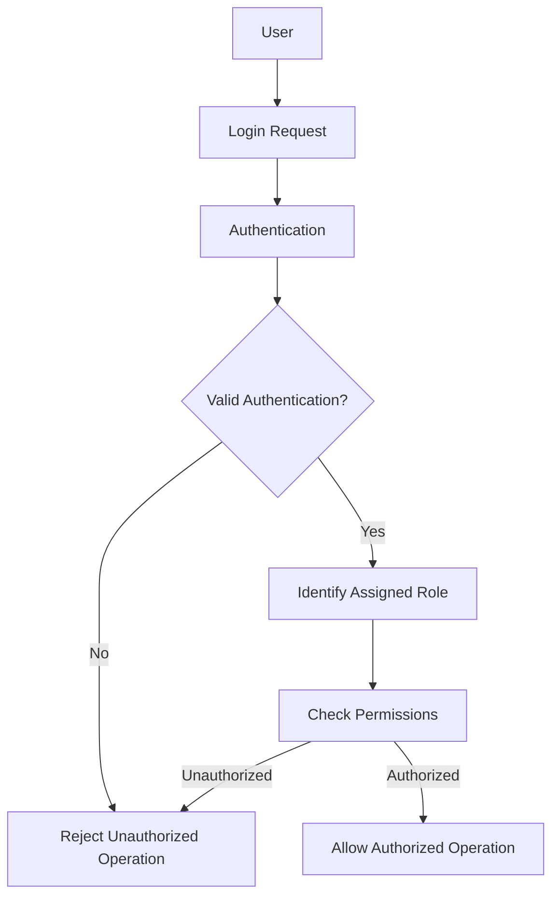

## 4.6 Scan Sequence Diagram

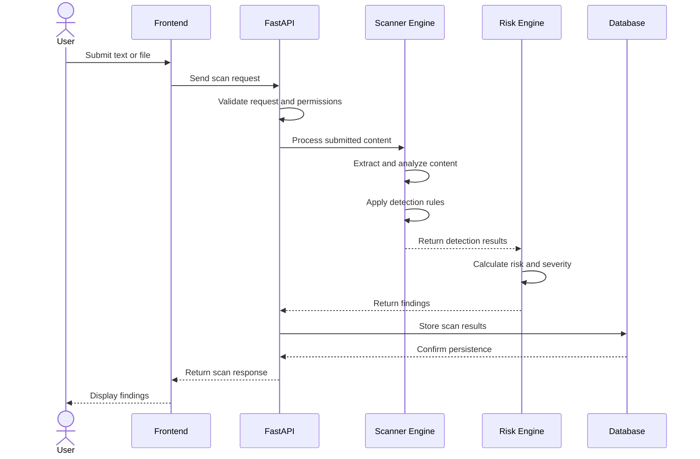

## 4.7 Logical Database Architecture (ERD Concept)

The following diagram represents logical data responsibilities, not a verified physical database schema.

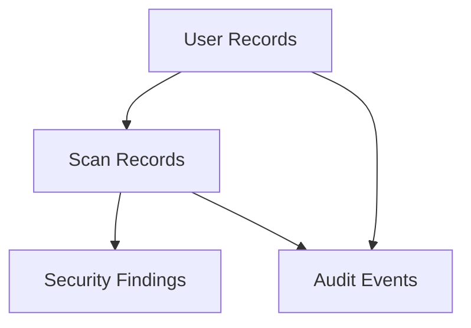

Exact table names, attributes, keys, and relationships must be confirmed against the SQLAlchemy models.

## 4.8 Security Architecture

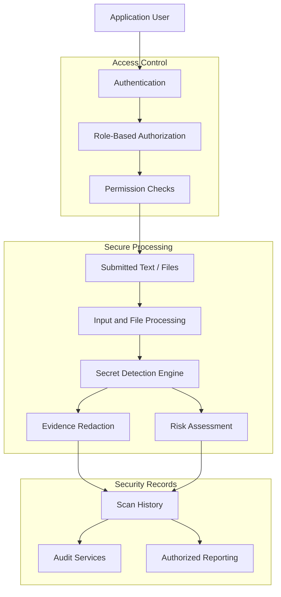

*This is a logical security architecture diagram, not a claim that every recommended production security control has been implemented.*

---

# 5. Technology Stack

| Category | Technology |
|---|---|
| Programming Language | Python |
| Backend Framework | FastAPI |
| Frontend | HTML, CSS, JavaScript |
| Database Access | SQLAlchemy |
| OCR Engine | Tesseract OCR |
| API Documentation | OpenAPI / Swagger UI |
| Testing Framework | Pytest |
| Version Control | Git |
| Repository Hosting | GitHub |

---

# 6. Backend API Documentation

The backend exposes API functionality through FastAPI.

## Main Scanning Endpoints

| Endpoint | Method | Purpose |
|---|---|---|
| `/scan` | POST | Scan submitted text |
| `/scan-file` | POST | Scan an uploaded file |
| `/docs` | GET | Interactive API documentation |

### Local API Documentation

When the backend is running, open:

```text
http://127.0.0.1:8001/docs
```

FastAPI provides interactive API documentation through Swagger UI.

Additional backend functionality supports authentication, dashboards, user management, scan history, and audit-related operations.

---

# 7. SOC Use Cases

REEMSEC DataGuard demonstrates workflows relevant to Security Operations Center activities and sensitive-data protection.

## Use Case 1: Exposed Credential Detection

**Objective:** Identify potentially exposed credentials in submitted content.

Workflow:

1. A user submits text or a supported file.
2. The backend processes the input.
3. The detection engine applies configured rules.
4. Potential secrets are identified.
5. Findings are classified by severity.
6. Sensitive evidence is redacted in displayed results.

**SOC Relevance:** Supports identification and initial review of exposed credentials.

## Use Case 2: Security Analyst Investigation

**Objective:** Review and analyze security findings.

Workflow:

1. The Security Analyst accesses the dashboard.
2. Available security findings are reviewed.
3. Scan history provides context about previous scans.
4. Intelligence Reports support security review.

**SOC Relevance:** Supports security visibility and investigation workflows.

## Use Case 3: Risk-Based Prioritization

**Objective:** Organize findings according to severity and calculated risk.

Workflow:

1. Detection rules identify potential security issues.
2. The risk engine calculates risk.
3. Findings are classified.
4. Results are presented for review.

**SOC Relevance:** Helps analysts prioritize findings for further investigation.

## Use Case 4: Security Auditability

**Objective:** Maintain visibility into relevant application activities.

Workflow:

1. Users perform application operations.
2. Relevant events are handled by audit services.
3. Scan records and audit-related information support review.
4. Authorized users access information according to their permissions.

**SOC Relevance:** Demonstrates audit logging and security accountability concepts.

### SOC Capabilities Demonstrated

- Secret and credential detection.
- Security findings analysis.
- Severity-based prioritization.
- Security monitoring visibility.
- Audit-related functionality.
- Role-based security access.

**Scope clarification:** REEMSEC DataGuard is a sensitive-data and secret detection platform. It is not presented as a complete SIEM or SOAR solution. External SIEM integrations, automated threat intelligence feeds, and automated incident-response orchestration are not claimed as implemented features.

---

# 8. Security Design Considerations

Security is a core consideration in the platform's design.

Key implementation areas include:

- Authentication and role-based authorization.
- Separation of user capabilities.
- Sensitive evidence redaction.
- Configurable detection rules.
- Scan history and audit services.
- Environment-based configuration.
- Exclusion of local secrets and database files from version control.

## Recommended Production Security Validation

Before production deployment, additional validation should include:

- Authentication and authorization testing.
- API access-control testing.
- File upload validation.
- Malicious file handling tests.
- Secret redaction verification.
- Dependency vulnerability scanning.
- Database security review.
- Rate limiting and resource-exhaustion testing.
- Secure deployment configuration.

---

# 9. Project Structure

```text
REEMSEC-DataGuard/
│
├── backend/
│   ├── app/
│   │   ├── scanner/
│   │   │   └── engine.py
│   │   │
│   │   ├── services/
│   │   │   ├── directory_scanner.py
│   │   │   ├── file_scanner.py
│   │   │   ├── scan_storage.py
│   │   │   └── audit_service.py
│   │   │
│   │   ├── main.py
│   │   ├── auth.py
│   │   ├── security.py
│   │   ├── permissions.py
│   │   ├── database.py
│   │   ├── models.py
│   │   ├── dashboard.py
│   │   ├── scan_history.py
│   │   ├── audit_logs.py
│   │   └── user_management.py
│   │
│   ├── requirements.txt
│   ├── .env.example
│   └── README.md
│
├── frontend/
│   └── index.html
│
├── .gitignore
└── README.md
```

---

# 10. Installation & Setup

## Prerequisites

- Python 3.10 or later.
- Git.
- Tesseract OCR for image and scanned-document OCR functionality.

## Step 1: Clone the Repository

```bash
git clone https://github.com/reemi01/REEMSEC-DataGuard.git
cd REEMSEC-DataGuard
```

## Step 2: Create a Virtual Environment

```bash
cd backend
python -m venv venv
```

### Windows PowerShell

```powershell
.\venv\Scripts\Activate.ps1
```

### Linux / macOS

```bash
source venv/bin/activate
```

## Step 3: Install Dependencies

```bash
pip install -r requirements.txt
```

## Step 4: Configure Environment Variables

Create a local `.env` file using `.env.example` as a reference.

Configure the required environment variables before starting the application.

Never commit real credentials, API keys, or production secrets to version control.

## Step 5: Install Tesseract OCR

Install Tesseract OCR and ensure its executable is accessible to the backend.

For Windows, configure the executable path if required by the application.

## Step 6: Start the Backend

From the `backend` directory:

```bash
uvicorn app.main:app --port 8001
```

Backend address:

```text
http://127.0.0.1:8001
```

## Step 7: Start the Frontend

Open a second terminal:

```bash
cd frontend
python -m http.server 5500
```

Open the application:

```text
http://127.0.0.1:5500
```

Keep both terminal sessions running while using the application.

---

# 11. Testing

The backend includes automated tests covering:

- API functionality.
- Detection engine behavior.
- File scanning.
- Directory scanning.

Run the tests from the `backend` directory:

```bash
pytest -v
```

### Functional Testing

Manual functional testing has been performed for:

- Text-based secret detection.
- File upload and scanning.
- Multiple-file scanning.
- OCR image processing.
- Scanned PDF processing.
- Role-based dashboards.
- Scan history.
- Intelligence Reports.
- Export functionality.

Functional testing does not replace a complete security audit or penetration test.

---

# 12. Application Screenshots

The following screenshots demonstrate the main interfaces and functionalities of REEMSEC DataGuard.

Screenshots are arranged vertically so that each feature can be inspected clearly.

### Screenshot Directory

```text
docs/
└── screenshots/
    ├── admin-dashboard.png
    ├── analyst-dashboard.png
    ├── employee-dashboard.png
    ├── text-scan.png
    ├── file-scan.png
    ├── security-findings.png
    ├── scan-history.png
    ├── intelligence-reports.png
    └── export-results.png
```

### 12.1 Admin Dashboard

Administrative dashboard providing access to authorized administrative functionality.

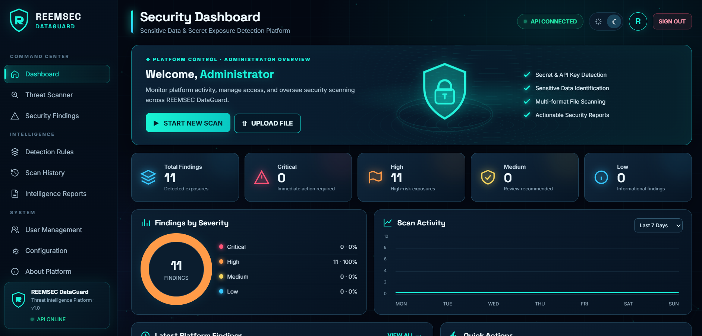

### 12.2 Security Analyst Dashboard

Security analysis interface for reviewing security findings and available reports.

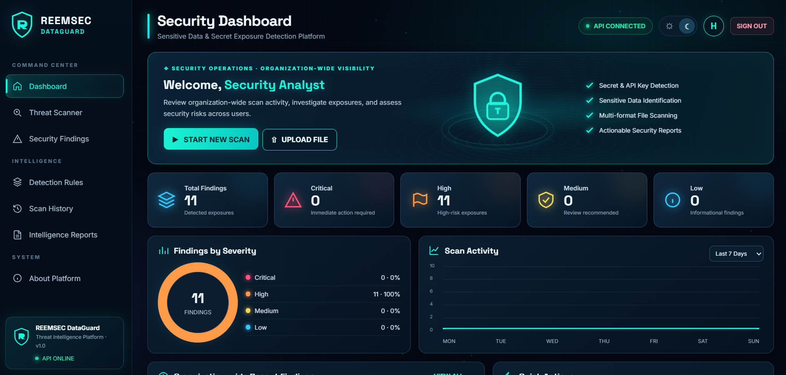

### 12.3 Employee Dashboard

Employee interface for accessing authorized scanning functionality.

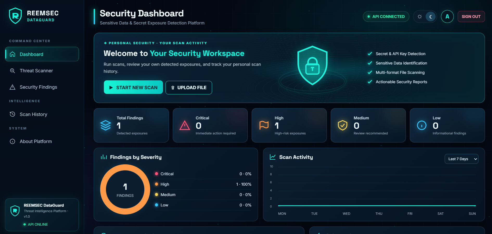

### 12.4 Text Scanning

Demonstration of text-based secret detection.

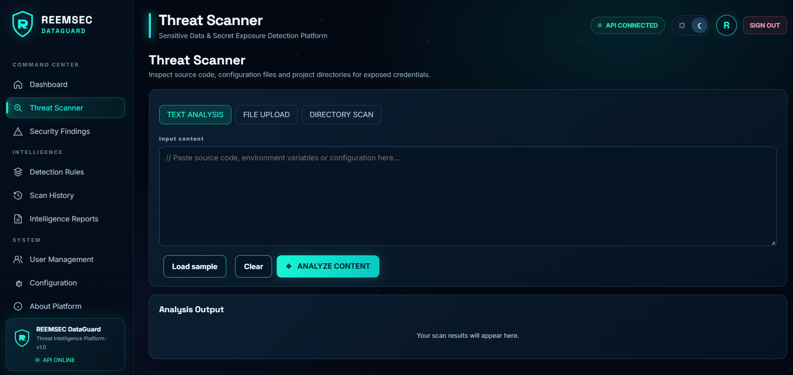

### 12.5 File Scanning

Demonstration of file upload and automated scanning.

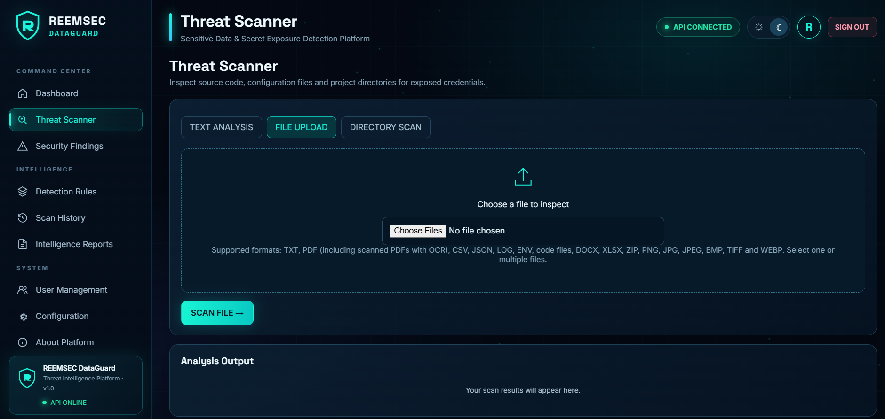

### 12.6 Security Findings

Displays detected findings, severity classifications, and redacted evidence.

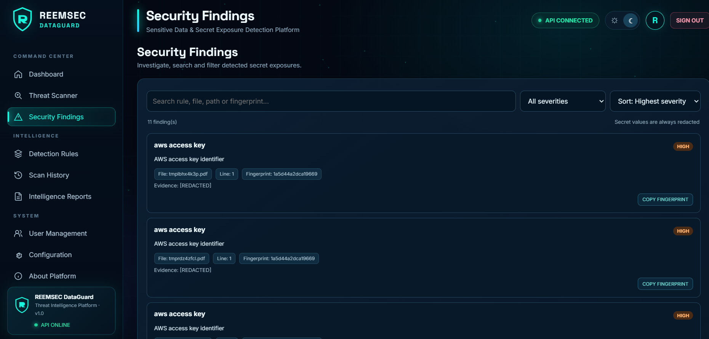

### 12.7 Scan History

Displays previously completed scanning operations.

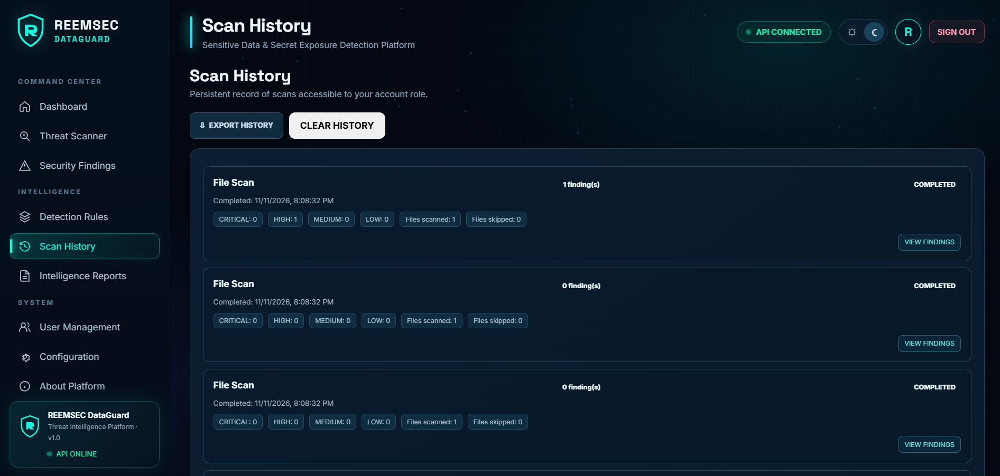

### 12.8 Intelligence Reports

Security reporting interface available to authorized roles.

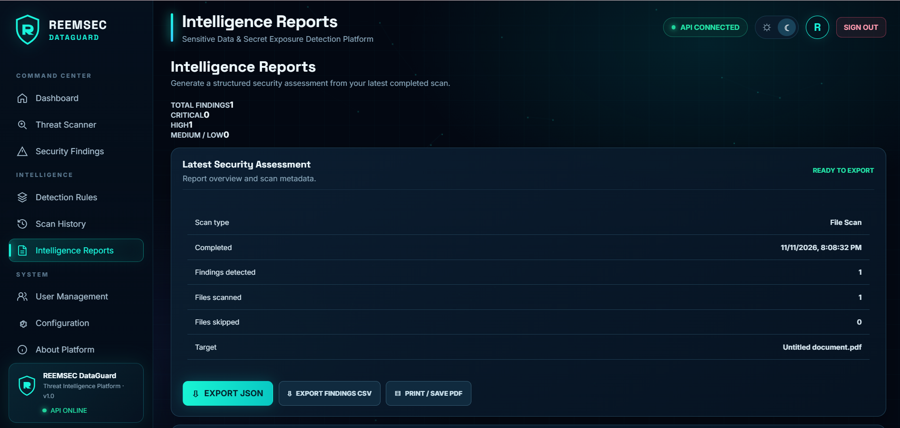


# 13. Roadmap

Potential future enhancements include:

- Expanded secret detection patterns.
- Additional file format support.
- Advanced detection rule management.
- Integration with external SIEM platforms.
- Threat intelligence enrichment.
- Automated security alerting.
- Advanced security analytics.
- Production deployment hardening.
- Expanded automated testing.

These are proposed enhancements and should not be interpreted as currently implemented functionality.

---

# 14. Responsible Use

REEMSEC DataGuard is intended for educational, research, and cybersecurity demonstration purposes.

When evaluating the platform:

- Use synthetic credentials and test data.
- Do not upload real production secrets or confidential documents unless the environment is explicitly authorized and appropriately protected.
- Review and validate detection results before making security decisions.
- Follow applicable security policies and data protection requirements.

---

# 15. Project Information

| Field | Details |
|---|---|
| Project Name | REEMSEC DataGuard |
| Category | Cybersecurity |
| Focus | Sensitive Data & Secret Exposure Detection |
| Backend | Python / FastAPI |
| Frontend | HTML / CSS / JavaScript |
| OCR | Tesseract OCR |
| Database Access | SQLAlchemy |
| Testing | Pytest |
| Version Control | Git |
| Repository | [GitHub - REEMSEC DataGuard](https://github.com/reemi01/REEMSEC-DataGuard) |

---
## Documentation

- [SOC Analysis Report](docs/SOC-Analysis-Report.md)

# Author

**Reem Bekdash**

Cybersecurity & Software Development

Creator and Developer of **REEMSEC DataGuard**.

GitHub: [@reemi01](https://github.com/reemi01)

---

<p align="center">
  <strong>REEMSEC DataGuard</strong>
  <br/>
  <i>Identify Exposure. Understand Risk. Improve Security.</i>
  <br/><br/>
  DETECT · ANALYZE · PROTECT
</p>

---

*This documentation describes the project based on its repository structure and reported functional testing. Architecture diagrams are logical representations. Database relationships, integrations, and security controls should be verified against the actual implementation before being represented as production-ready capabilities.*